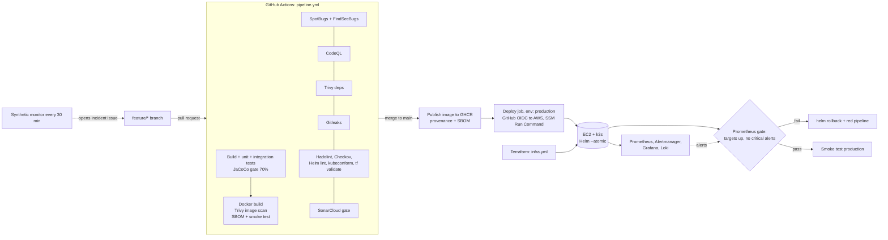

# PropertyHub Ireland (L00205200): a CI/CD pipeline for a Java web app

A Daft.ie and Zillow-style property marketplace for Ireland, built with **Spring Boot 3 / Java 21**. A complete
DevOps pipeline takes it from a feature branch to a **monitored Kubernetes deployment on AWS**.

> **Atlantic Technological University (ATU)** · Postgraduate DevOps · Task 3: CI/CD Pipeline
> Student: **Raju Augustine (L00205200)** · Cloud: AWS eu-west-1 (Ireland)

---

## 1. What the app does

| Feature | Inspired by | Where |
|---|---|---|
| Search homes to **buy or rent**: county, type, price, beds, **BER** rating, new builds, price-reduced, keyword, 5 sort orders | Daft.ie, Rightmove | `/search` |
| **Instant valuation** with price range and 12-month forecast | Zillow "Zestimate" | `/sell`, every listing |
| **Deal score**: asking price vs. estimate ("Great price" / "Above estimate") | Redfin | listing cards |
| **Rental potential**: estimated rent, gross & net yield, buy-to-let cashflow, cash-on-cash return | investor tools | listing page, `/yield-calculator` |
| **What can I afford?** Central Bank of Ireland rules (FTB 4× income, second-time 3.5×, 90% LTV, BTL 70%), stamp duty (1% / 2% / 6%), **Help to Buy** (≤ €30k on new builds ≤ €500k), +2% rate stress test | MyHome, bank calculators | `/affordability` |
| **Buyer income needed** and cash-on-day-one for every listing | Zillow affordability | listing page |
| Live **mortgage calculator**, price history, walk/transit scores, similar homes, agent enquiry | Zillow, Daft | listing page |
| **Market insights** by county: price, €/m², rent, yield, growth, income needed | Daft reports | `/insights` |
| Sell or let your home: valuation, then publish a listing | Daft "Sell" | `/sell` |
| JSON **REST API** | | `/api/listings`, `/api/valuation`, `/api/affordability`, `/api/yield`, `/api/insights` |

Listings are fictional demo data and market figures are illustrative. The lending rules are accurate as of
November 2026 ([Central Bank](https://www.centralbank.ie/consumer-hub/explainers/what-are-the-mortgage-measures),
[Revenue stamp duty](https://www.revenue.ie/en/property/stamp-duty/property/stamp-duty-property/rates.aspx)).

---

## 2. Pipeline at a glance



| Rubric criterion | How this repo meets it |
|---|---|
| **Source code management (10)** | GitHub Flow: `feature/*` → PR → `main`, branch protection with required checks, PR template, Dependabot, tags `vX.Y.Z` create GitHub Releases (`release.yml`) |
| **Automated builds & testing (20)** | `mvn verify`: **unit tests** (Surefire) + **integration tests** (Failsafe: MockMvc, real HTTP on a random port, Prometheus endpoint) + **JaCoCo coverage gate** + container smoke test + post-deploy smoke test |
| **Static analysis & security (15)** | **SpotBugs+FindSecBugs**, **CodeQL**, **SonarCloud** quality gate (optional), **Trivy** (dependencies, secrets, image, IaC), **Gitleaks**, **Hadolint**, **Checkov**. Builds **fail** on CRITICAL CVEs, SAST findings, leaked secrets and IaC violations |
| **Containerisation & orchestration (20)** | Multi-stage build → **distroless, non-root** image, layered jar, read-only rootfs; **Docker Compose** local stack; **Helm chart**: probes, HPA, PDB, NetworkPolicy, securityContext, ServiceMonitor, PrometheusRule |
| **Deployment to cloud (20)** | **Terraform** or **CloudFormation** (VPC, EC2, IAM, OIDC, SSM) with remote **S3 state + locking**; **GitHub OIDC**, so no AWS keys are stored; secrets in **SSM Parameter Store**; zero-SSH deploys via **SSM Run Command**; `helm --atomic` auto-rollback; `infra.yml` runs plan/apply/destroy |
| **Monitoring & logging (15)** | **Prometheus + Grafana** dashboard (golden signals, business metrics, JVM, logs), **Loki** logs, **Alertmanager** alerts (down, 5xx rate, p95 latency, CPU, restarts). **Feedback loops:** deploy gate rolls back on alerts; synthetic monitor opens GitHub issues |

### Prefer Jenkins? (alternative to GitHub Actions)

The same pipeline also exists as a **`Jenkinsfile`**: build, tests and coverage, SpotBugs, a SonarQube quality gate,
Trivy, Gitleaks, Hadolint, Checkov, an image scan with SBOM, a smoke test, the Docker Hub push, the SSM deploy and
production checks. Jenkins and SonarQube run in Docker on an EC2 instance created by
`infra/cloudformation/jenkins.yaml`, with Jenkins configured as code.
**Step-by-step guide: [`jenkins/README.md`](jenkins/README.md).**

---

## 3. Repository layout

```
├── src/main/java/ie/propertyhub   # domain, calculators (plain Java), service, web, API
├── src/test/java                  # *Test = unit (Surefire), *IT = integration (Failsafe)
├── Dockerfile                     # multi-stage, distroless, non-root
├── docker-compose.yml             # app + Prometheus + Alertmanager + Grafana + Loki + Alloy
├── helm/propertyhub               # Kubernetes chart (dashboards/ and files/alerts.yml shared with compose)
├── infra/terraform                # AWS infrastructure as code (Terraform)
├── infra/cloudformation           # same infrastructure as a CloudFormation template (+ Learner Lab mode)
├── monitoring/                    # local Prometheus, Alertmanager, Alloy, Grafana provisioning
├── Jenkinsfile                    # Jenkins version of the pipeline
├── jenkins/                       # Jenkins image, configuration as code, Compose with SonarQube, guide
├── scripts/                       # deploy, smoke test, state bootstrap, GitHub variables
└── .github/                       # pipeline.yml, release.yml, infra.yml, synthetic-monitor.yml, dependabot
```

---

## 4. Prerequisites (Windows)

Install these, then use **Git Bash** for the shell commands below:

| Tool | Version | Check |
|---|---|---|
| Git for Windows (includes Git Bash) | any | `git --version` |
| JDK (Temurin) | 21 | `java -version` |
| Maven | 3.9+ (or run builds in Docker / IntelliJ) | `mvn -v` |
| Docker Desktop | recent | `docker version` |
| AWS CLI v2 + Session Manager plugin | v2 | `aws --version` |
| Terraform | **≥ 1.10** | `terraform -version` |
| GitHub CLI | any | `gh auth status` |
| jq | any (`winget install jqlang.jq`) | `jq --version` |

> Use your **personal AWS account**. AWS Academy Learner Lab accounts can't create IAM roles or OIDC
> providers, which the secure deployment needs.

---

## 5. Step-by-step

### Step 1: Create the GitHub repository and push

```bash
cd L00205200-propertyhub
git init -b main
git add .
git commit -m "feat: PropertyHub Ireland app with CI/CD pipeline"
gh repo create L00205200-propertyhub --public --source . --push   # public = free Actions minutes, CodeQL, GHCR
git checkout -b develop && git push -u origin develop && git checkout main
```

Then in GitHub open **Settings → Branches → Add rule** for `main`:
- Require a pull request before merging (1 approval is optional when you work solo)
- Require status checks to pass: *Build & test*, *SpotBugs*, *CodeQL*, *Trivy filesystem scan*, *Gitleaks*, *IaC lint & security*, *Docker build, scan & container smoke test*
- Require branches to be up to date. Do not allow force pushes.

Also open **Settings → Code security** and enable Dependabot alerts and secret scanning.

### Step 2: Build and run locally

```bash
mvn verify                       # unit + integration tests + coverage gate (target/site/jacoco/index.html)
docker compose up -d --build     # app + full monitoring stack
```

| URL | What |
|---|---|
| http://localhost:8080 | PropertyHub |
| http://localhost:8080/actuator/prometheus | raw metrics |
| http://localhost:3000 | Grafana (admin/admin). Open **Dashboards → PropertyHub → Service Overview** |
| http://localhost:9090/alerts | Prometheus alert rules |
| http://localhost:9093 | Alertmanager |

Trigger an alert locally (this is good demo material):
```bash
for i in $(seq 1 400); do curl -s -o /dev/null localhost:8080/api/chaos/error; sleep 0.3; done
```
After about 2 minutes **PropertyHubHighErrorRate** goes *Firing* in Prometheus, Alertmanager and the Grafana panel.
`docker compose down` stops everything.

### Step 3: Work with feature branches and pull requests

```bash
git checkout -b feature/compare-listings
# ...make a change + a test...
git commit -am "feat(search): add compare listings"
git push -u origin feature/compare-listings
gh pr create --base main --fill
```
The PR runs every build, test and security job. Merge only when all checks are green; **squash merge** keeps
the history clean. Use conventional commit messages (`feat:`, `fix:`, `ci:`, `docs:`, `chore:`). Do at least 3–4
real feature branches and PRs before the demo, so the history shows the workflow.

### Step 4: Check the first pipeline run

Open **Actions → CI/CD Pipeline**. On `main` with no AWS configured yet, everything up to **Publish image to
GHCR** runs. Deploy is skipped until Step 8.

- If **Trivy** fails on a CRITICAL CVE, the enforcement gate is working: bump the dependency (Dependabot
  usually opens the PR), or add a documented, time-boxed entry to `.trivyignore`.
- **Terraform fmt** fails? Run `terraform fmt -recursive infra/terraform` and commit.

### Step 5: Make the container image public

After the first `publish` run: **your GitHub profile → Packages → l00205200-propertyhub → Package settings →
Change visibility → Public**. This lets the cluster pull the image without credentials.

### Step 6 (optional): SonarCloud quality gate

1. Sign in at sonarcloud.io with GitHub and import the repo. Turn **Automatic Analysis off** (CI analysis is used).
2. **My Account → Security** → generate a token → GitHub **Settings → Secrets and variables → Actions → Secrets**: `SONAR_TOKEN`.
3. Add **Variables** `SONAR_ORGANIZATION` (your org key) and `SONAR_PROJECT_KEY`.
The `sonarcloud` job then runs and **fails the pipeline if the quality gate fails**.

### Step 7: Provision AWS with Terraform

```bash
aws configure                    # personal account, region eu-west-1 (keys stay on your laptop only)
aws sts get-caller-identity

# Safety net: a budget alert at $10/month (Billing console → Budgets) is strongly recommended.

bash scripts/bootstrap-tf-state.sh eu-west-1          # S3 state bucket (versioned, encrypted, private)
cd infra/terraform
cp terraform.tfvars.example terraform.tfvars           # set github_repository = "YOUR_USER/L00205200-propertyhub"
terraform fmt -recursive
terraform init -backend-config=backend.hcl
terraform plan -out tfplan
terraform apply tfplan
terraform output
```

The EC2 node takes **about 8–12 minutes** after `apply` to install k3s, Prometheus, Grafana and Loki. To watch it:
```bash
aws ssm start-session --target $(terraform output -raw instance_id)
sudo tail -f /var/log/propertyhub-bootstrap.log        # ends with "Bootstrap complete"
```

### Step 7 (alternative): Provision AWS with CloudFormation

`infra/cloudformation/propertyhub.yaml` builds the same infrastructure as the Terraform code: VPC, subnet, IGW,
routes, HTTP-only security group, hardened EC2 with k3s and the monitoring stack, a Grafana password generated in
**Secrets Manager**, and the GitHub OIDC deploy role. A **WaitCondition** makes the stack wait until the node
reports that bootstrap has finished, so `CREATE_COMPLETE` means the cluster is ready.

| Parameter | Personal account | AWS Academy Learner Lab |
|---|---|---|
| `CreateIamRoles` | `true` | `false` (Learner Lab can't create IAM roles) |
| `ExistingInstanceProfile` | ignored | `LabInstanceProfile` |
| `GitHubRepository` | `YOUR_USER/L00205200-propertyhub` | leave blank |

**CLI (recommended):**
```bash
# edit infra/cloudformation/params-personal.json (GitHubRepository) first
bash scripts/cfn-deploy.sh personal propertyhub eu-west-1
#   Learner Lab (copy the lab's AWS CLI credentials into ~/.aws/credentials first; region us-east-1):
bash scripts/cfn-deploy.sh learner-lab propertyhub us-east-1
```

**Console:** CloudFormation → *Create stack* → *Upload a template file* → `propertyhub.yaml`. Fill in the
grouped parameters, tick *I acknowledge that AWS CloudFormation might create IAM resources with custom names*,
then *Submit*. Watch the **Events** tab; `BootstrapWaitCondition` completes after about 10–15 minutes.

**Then connect GitHub:**
```bash
bash scripts/set-github-vars-cfn.sh propertyhub eu-west-1
```
- **Personal account:** sets `AWS_DEPLOY_ROLE_ARN`, and the pipeline uses OIDC.
- **Learner Lab:** there is no OIDC role, so add the lab's temporary `AWS_ACCESS_KEY_ID`, `AWS_SECRET_ACCESS_KEY`
  and `AWS_SESSION_TOKEN` as repository **secrets**. The deploy job falls back to them automatically.
  These credentials change each lab session, so update them before you deploy. Learner Lab stops the EC2
  instance when the session ends; k3s restarts by itself when you start the lab again.

Grafana password: run the `GrafanaPasswordCommand` value from the stack **Outputs**.
To tear down: `bash scripts/cfn-delete.sh propertyhub eu-west-1` (or *Delete* in the console).

### Step 8: Connect GitHub to AWS (no stored keys)

```bash
cd ../..
bash scripts/set-github-vars.sh     # writes EC2_INSTANCE_ID, APP_URL, GRAFANA_URL, AWS_DEPLOY_ROLE_ARN, ...
```
Then in GitHub **Settings → Environments**:
- Create **`production`**. Optionally add yourself as a *Required reviewer* (a manual approval gate) and limit deployment branches to `main`.
- Create **`infrastructure`** with yourself as a *Required reviewer*. It is used by `infra.yml`.

The AWS roles only trust tokens from **this repo and these environments**, so other repos and branches can't deploy.

### Step 9: Deploy

Merge a PR to `main`, or run **Actions → CI/CD Pipeline → Run workflow** on `main`. The `deploy` job:
1. assumes `propertyhub-github-deploy` through **OIDC**
2. sends `scripts/deploy-on-node.sh` to the node through **SSM Run Command** (port 22 is closed)
3. runs `helm upgrade --atomic`, which rolls back automatically if pods never become ready
4. passes a **Prometheus gate**: new pods must be scraped and no critical alert may fire, otherwise it runs `helm rollback` and fails the run
5. `verify` smoke-tests production and checks `/actuator/info` reports the **new commit SHA**

Open the app at `APP_URL`. Grafana is at `APP_URL/grafana`; the user is `admin` and the password comes from:
```bash
cd infra/terraform && $(terraform output -raw grafana_password_command)
```
Useful cluster commands (inside `aws ssm start-session`):
```bash
sudo -i
kubectl -n propertyhub get deploy,pods,hpa,svc,ingress
helm -n propertyhub history propertyhub
kubectl -n monitoring get pods
```

### Step 10: Show monitoring, alerts and feedback loops

- **Dashboard:** Grafana → *PropertyHub Ireland (L00205200) - Service Overview*: request rate, error %, p50/p95/p99 latency,
  searches/valuations/affordability checks, active listings, heap, CPU, GC, and live **Loki logs**.
- **Alert:** run the chaos loop from Step 2 against `APP_URL`, then show *PropertyHubHighErrorRate* firing in
  Grafana → Alerting (and the "Firing alerts" panel).
- **Pipeline feedback:** while an alert is firing, re-run the pipeline. The deploy gate refuses the release and rolls back.
- **Synthetic monitor:** `synthetic-monitor.yml` probes production every 30 minutes. A failure opens an `incident` issue;
  recovery closes it.

### Step 11: Cut a release

```bash
git checkout main && git pull
git tag -a v1.0.0 -m "First release" && git push origin v1.0.0
```
`release.yml` builds and tests, pushes `ghcr.io/<you>/l00205200-propertyhub:1.0.0`, and publishes a GitHub Release with
generated notes, the jar and the packaged Helm chart.

### Step 12: Tear down (avoid charges)

```bash
cd infra/terraform && terraform destroy
```
Running cost is roughly **$2–3 per day** (t3.large + 30 GB gp3 + public IPv4). Destroy the stack after the demo and
re-create it in about 15 minutes with `terraform apply`. You can also run **Actions → Infrastructure** with `destroy`.

---

## 6. Demo script (about 10 minutes)

1. **Repo tour (1 min):** README diagram, folders, branch protection rule, merged PRs, tags/releases.
2. **Git workflow (1 min):** create `feature/demo-change`, edit a template or text, push, open PR.
3. **CI (3 min):** while the PR runs, walk through the jobs: tests + coverage report, SpotBugs, CodeQL alerts in the Security tab,
   Trivy SARIF, Gitleaks, Checkov/Hadolint, image scan + SBOM. Optional: show a failing gate (e.g. add a fake AWS key in a branch → Gitleaks fails).
4. **CD (2 min):** merge → publish → deploy (show OIDC, SSM output, Helm atomic, Prometheus gate) → verify; open the live site.
5. **Cloud & IaC (1 min):** `terraform plan` shows no changes (reproducible), with no SSH and no stored keys.
6. **Monitoring (2 min):** Grafana dashboard + Loki logs, trigger the chaos alert, show Alertmanager/Grafana firing, explain the rollback gate and incident issues.

---

## 7. Security and secret management

- **No long-lived cloud credentials in GitHub:** OIDC roles are scoped to `repo:<owner>/<repo>:environment:production|infrastructure`.
- Deploy role permissions: `ssm:SendCommand` on **one instance** and one document. Nothing else.
- Grafana password: generated by Terraform, stored as an **SSM SecureString**, read by the node at boot, and kept in a Kubernetes Secret. It never appears in git.
- Node: IMDSv2 only, encrypted EBS, **no SSH port**, default security group locked down, k3s secrets encryption.
- Pods: non-root UID 65532, read-only root filesystem, all capabilities dropped, seccomp `RuntimeDefault`, NetworkPolicy, no service-account token.
- App: CSP / X-Frame-Options / nosniff / Referrer-Policy headers, Bean Validation on all inputs, no stack traces in errors.
- Supply chain: pinned base images, SBOM (CycloneDX), build provenance attestation, Dependabot.

---

## 8. Troubleshooting

| Symptom | Fix |
|---|---|
| Deploy job skipped | `EC2_INSTANCE_ID` variable not set. Run Step 8. |
| `Not authorized to perform sts:AssumeRoleWithWebIdentity` | `github_repository` in tfvars must match `owner/repo` exactly (case-sensitive); the job must use environment `production` |
| Pods `ImagePullBackOff` | Make the GHCR package public (Step 5) |
| Deploy waits for "bootstrap" | Node still installing; see `/var/log/propertyhub-bootstrap.log` |
| `EntityAlreadyExists` for the OIDC provider | Set `create_github_oidc_provider = false` |
| Grafana 404 at `/grafana` | Wait for bootstrap; check `kubectl -n monitoring get ingress` |
| Compose logs missing in Grafana | Docker Desktop: Settings → General → enable "Expose daemon on default socket" (Alloy reads `/var/run/docker.sock`) |

---

## 9. Tools used (for Task 4)

| Stage | Tool | Why |
|---|---|---|
| SCM | GitHub, GitHub Flow, branch protection, Dependabot | PR-based review, required checks |
| CI | GitHub Actions | native to the repo, OIDC to AWS, free for public repos |
| Build/test | Maven, JUnit 5, AssertJ, MockMvc, Failsafe, JaCoCo | unit + integration tests, coverage gate |
| SAST | SpotBugs + FindSecBugs, CodeQL, SonarCloud | bugs + security patterns + quality gate |
| SCA / secrets / IaC | Trivy, Gitleaks, Checkov, Hadolint, kubeconform | CVEs, leaked secrets, misconfigurations |
| Container | Docker (BuildKit), distroless Java 21 | small, no shell, non-root |
| Orchestration | k3s (Kubernetes), Helm | lightweight K8s on one EC2 node; templated, versioned releases |
| IaC | Terraform (S3 backend with native locking) | reproducible AWS infrastructure |
| Secrets | GitHub OIDC, AWS SSM Parameter Store | no static keys, encrypted secrets |
| Deploy | AWS SSM Run Command | no SSH keys or open ports |
| Monitoring | Prometheus, Alertmanager, Grafana, Micrometer | metrics, alerts, dashboards |
| Logging | Loki + Promtail (K8s), Alloy (Compose), ECS JSON logs | centralised, searchable logs in Grafana |
